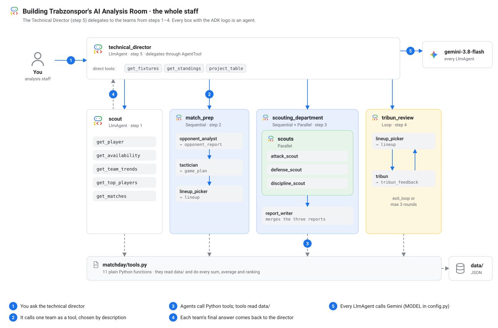
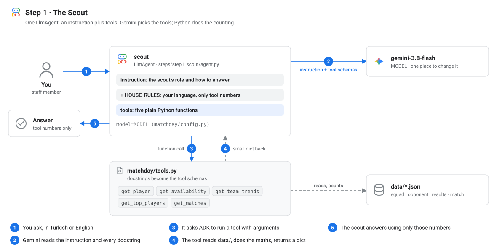
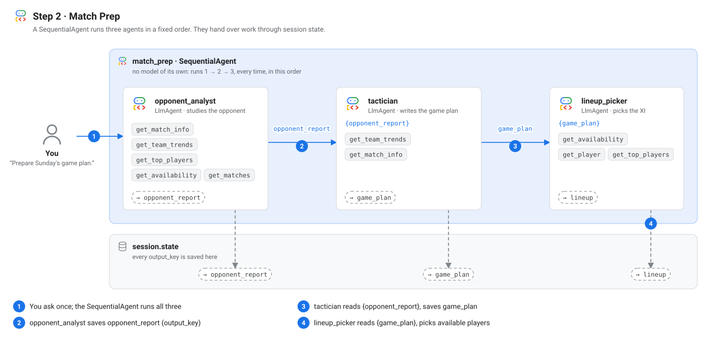
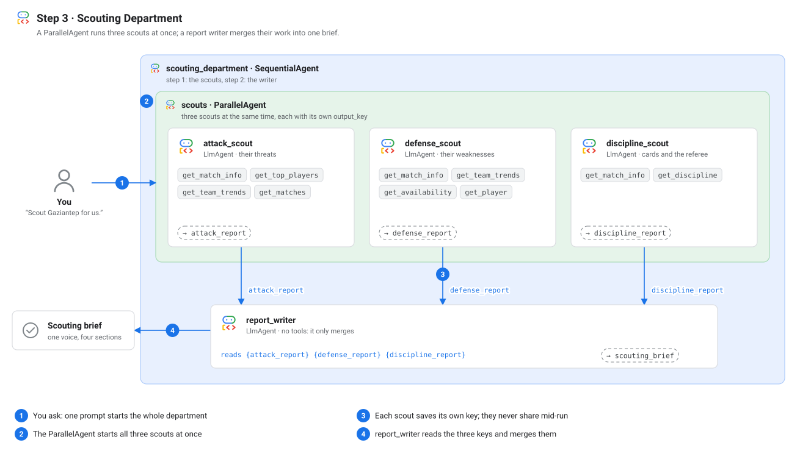
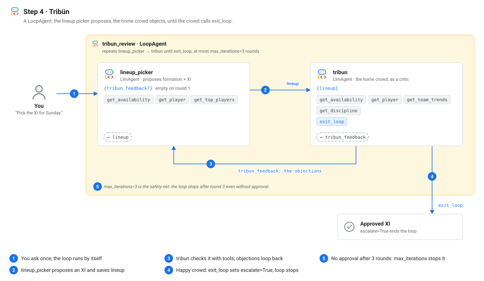
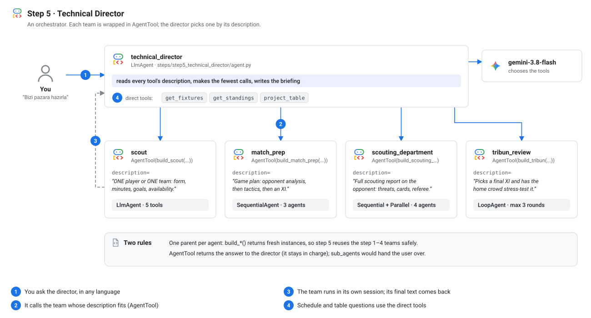
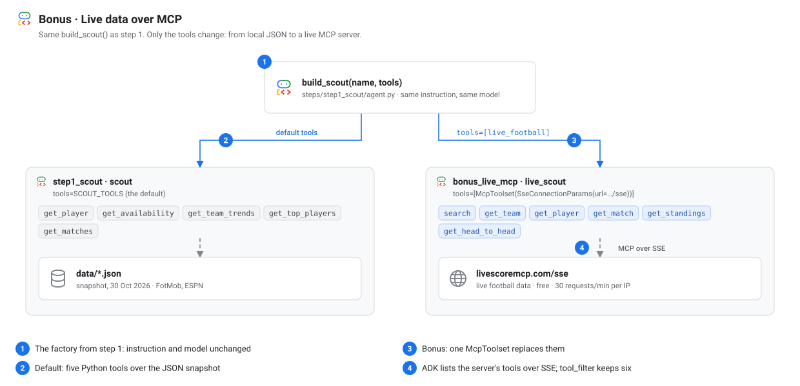

# Building Trabzonspor's AI Analysis Room

It's Saturday night. Trabzonspor host Gaziantep FK tomorrow, Sunday 1 November 2026, 16:00 Istanbul time, in Round 10 of the Süper Lig. You're the club's new analysis staff, and the coaches want a briefing by morning: who the opponent is, how we play them, who starts, and what could go wrong.

You're going to build that staff out of agents. Each step adds one staff member, and each one is an agent pattern you'll keep using long after this match:

1. **The Scout:** one agent with tools.
2. **Match Prep:** agents that run in a fixed order.
3. **Scouting Department:** agents that run at the same time.
4. **Tribün:** two agents in a loop, one proposing, one criticising.
5. **Technical Director:** an agent that delegates to all the others.

It all runs on Google's [Agent Development Kit](https://adk.dev) (ADK) for Python, a free Gemini API key, and real data from both teams' last ten matches. I ran this as a workshop at DevFest Trabzon 2026; this guide is for everyone who wasn't in the room.

[](images/overview.svg "Open full size")

*The whole staff you'll have by the end. Every box with the ADK logo is an agent. Tap to open full size.*

## Setup

You need Python 3.11 or newer, [uv](https://docs.astral.sh/uv/), and a Gemini API key. The key is free at [aistudio.google.com/apikey](https://aistudio.google.com/apikey), no credit card needed.

```bash
curl -LsSf https://astral.sh/uv/install.sh | sh     # installs uv
git clone https://github.com/omarcevi/trabzonspor_analyst
cd trabzonspor_analyst
cp .env.example .env                                 # paste your key into .env
uv sync
uv run adk web steps
```

Open http://localhost:8000, pick a step from the dropdown and ask it something. The events panel shows every tool call and hand-off.

<!-- SCREENSHOT: adk web with the app dropdown open, showing the six step folders -->

The `.env` file holds your key, `GOOGLE_GENAI_USE_VERTEXAI=FALSE` (the free Gemini API, not Vertex AI) and `MODEL=gemini-3.8-flash`. The model is set in one place, `matchday/config.py`:

<!-- source: matchday/config.py -->
```python
MODEL_NAME = os.getenv("MODEL", "gemini-3.8-flash")

# Free-tier keys hit rate limits when many agents run at once: retry 429s with backoff.
MODEL = Gemini(
    model=MODEL_NAME,
    retry_options=types.HttpRetryOptions(attempts=5, initial_delay=2, max_delay=30),
)
```

The retries matter more than they look: one question to step 5 can mean a few dozen model calls, and on a free key that hits a `429` now and then. If your laptop won't cooperate, `notebook/match_day_agents.ipynb` runs the same files in Colab, one cell per step.

## The data

The `data/` folder is a snapshot I took on 30 October 2026 from FotMob, ESPN and Turkish match reports: the fixture and the referee (`match.json`), both squads with each player's availability for Sunday and last-ten-match stats (`squad.json`, `opponent.json`), every match with goals, cards and xG (`results.json`), and the league table and next fixtures.

There are real stories in there. Trabzonspor won all four home matches in the sample, 13–0 on aggregate. Gaziantep concede late: a third of their goals against came after the 75th minute. Gaziantep's most-used player is suspended. Salah has 8 goals and 5 assists in ten matches, and Franculino, the second-best scorer, is doubtful. On Thursday, four days after this match, Trabzonspor play Freiburg in Europe.

Two rules shape every tool. **First, `null` means "not shown on the source", never zero.** There's no xG for Gaziantep's cup game, and a model handed `None` may read it as zero, so every tool says `"not available"` instead (a test checks that no `None` leaks out). **Second, tools return small, computed answers, not raw files.** Paste `results.json` (126 KB) into a prompt and the model gets most of it right. "Most" is the problem. So, as the header of `matchday/tools.py` puts it: LLMs interpret, tools count.

## Step 1 · The Scout

**The pattern:** a single `LlmAgent` is an instruction (who it is, how it works) plus tools (plain Python functions it can call).

[](images/step1-scout.svg "Open full size")

*One agent, five tools. Gemini decides which tool to call; Python does the work. Tap to open full size.*

Here's the whole agent:

<!-- source: steps/step1_scout/agent.py -->
```python
def build_scout(
    name: str = "scout",
    description: str = "Looks up players and team form: stats, availability, top performers, recent results.",
    tools: list | None = None,
) -> LlmAgent:
    return LlmAgent(
        name=name,
        model=MODEL,
        description=description,
        instruction="""
You are the scout on Trabzonspor's analysis staff. "We" and "us" always mean Trabzonspor.
Answer questions about players and teams.

How you work:
1. Look everything up with your tools before you answer. Never answer from memory.
2. "In form" means recent output and ratings: check top players by goals, assists and avg_rating.
3. "Who can't play" means the availability list: out and doubtful players with the reason.
4. Name the player, then the numbers that back up your point.
""" + HOUSE_RULES,
        tools=tools or SCOUT_TOOLS,
    )


root_agent = build_scout()
```

`HOUSE_RULES` comes from `config.py` and goes into every agent: answer in the user's language, and only use numbers from a tool. Type in Turkish and you get Turkish back. The agent is built by a function, `build_scout()`, which pays off in step 5.

ADK turns each tool's type hints and docstring into the schema the model sees, so the docstring is written for the model: it's all it knows about the tool. Inside, the tools do the counting, like the share of goals per 15-minute window:

<!-- source: matchday/tools.py -->
```python
    t["goals_by_15min"] = {
        window: {
            **g,
            "pct_of_goals_scored": round(100 * g["scored"] / total_for) if total_for else NA,
            "pct_of_goals_conceded": round(100 * g["conceded"] / total_against) if total_against else NA,
        }
        for window, g in t["goals_by_15min"].items()
    }
```

Name matching ignores Turkish and Polish letters (`simsir` finds Aral Şimşir), and bad input returns an error with suggestions instead of raising.

I asked: *"Who's in form for us, and who can't play Sunday?"*

The scout called `get_availability` once and `get_top_players` three times (goals, assists, avg_rating), then answered in 12 seconds. Trimmed:

> **In Form (Last 10 Matches)**
> - **Mohamed Salah** (Available): 8 goals, 5 assists, and an 8.03 average rating in 10 matches (802 minutes).
> - **Ernest Muçi** (Available): 2 goals, 5 assists, and a 7.14 average rating in 9 matches (549 minutes).
> - *(Note: **Franculino** has also been in top form with 7 goals, 2 assists, and a 7.75 average rating in 8 matches / 545 minutes, but he is currently doubtful).* …

<!-- SCREENSHOT: adk web, step1_scout, the events panel showing the get_top_players and get_availability calls -->

**Use it when** one job needs a handful of tools and some judgement: a support bot, a data assistant, a code helper.

**Avoid it when** the instruction grows into a long list of "first do this, then that". That's a workflow, and step 2 is for that.

**The gotcha: tools do the maths.** Every number an agent states should come out of a tool. Give the model computed answers (`pct_of_goals_conceded: 33`), not raw rows to add up. My smoke script flags any number in an answer that appears in no tool result; step 5 shows what happens when you skip this.

## Step 2 · Match Prep

**The pattern:** a `SequentialAgent` runs its sub-agents in a fixed order, every time, with no model of its own. They hand work over through session state.

[](images/step2-match-prep.svg "Open full size")

*Three agents in a row. Each saves its answer with output_key; the next reads it with a placeholder. Tap to open full size.*

The opponent analyst studies Gaziantep and writes a report. The tactician turns the report into a game plan. The lineup picker turns the plan into an XI. Here's the middle one, and the line that chains them:

<!-- source: steps/step2_match_prep/agent.py -->
```python
    tactician = LlmAgent(
        name="tactician",
        model=MODEL,
        instruction="""
You are Trabzonspor's tactician. Opponent report from the analyst:
{opponent_report}

Check our own form with get_team_trends("Trabzonspor"), then write a game plan:
formation, how we attack, how we defend, and what to do in each phase of the match.
""" + HOUSE_RULES,
        tools=[get_team_trends, get_match_info],
        output_key="game_plan",
    )
```

<!-- source: steps/step2_match_prep/agent.py -->
```python
    return SequentialAgent(name=name, description=description, sub_agents=[opponent_analyst, tactician, lineup_picker])
```

`output_key="opponent_report"` saves the analyst's final answer in session state. `{opponent_report}` in the tactician's instruction pastes it in before the tactician's model call. No glue code.

I asked: *"Prepare Sunday's game plan."*

Three agents in a row, about two minutes. The tactician, using the analyst's report:

> **Exploit High Conceding Windows:** Gaziantep FK have conceded 67% of their goals in the second half (10 of 15 goals in their last 10 matches). Increase tempo immediately after half-time.

And the lineup picker, after checking availability:

> **Formation: 4-1-4-1** · André Onana; Wagner Pina, Stefan Savić, Chibuike Nwaiwu, Mustafa Eskihellaç; Fabinho; Mohamed Salah, Melih Kabasakal, Ernest Muçi, Noah Saviolo; Aral Şimşir.

In an earlier run the lineup picker tried two names from its own memory that aren't in this squad. `get_player` answered `{"error": "No player called 'Destan' in either squad.", ...}` and it moved on to real players: the error-instead-of-exception rule paying off.

<!-- SCREENSHOT: adk web, step2_match_prep, the State tab showing opponent_report, game_plan and lineup -->

**Use it when** the steps are always the same and each needs the previous one's output: research, plan, act.

**Avoid it when** the steps are independent (step 3 is faster) or the next step depends on what happened.

**The gotcha: `output_key` and placeholders are a contract.** A `{placeholder}` with no value in state raises a `KeyError` before the model is called. Keep the names identical, and make sure the writer runs before the reader.

## Step 3 · Scouting Department

**The pattern:** a `ParallelAgent` starts its sub-agents at the same time, each writing its own state key. A `SequentialAgent` around it lets a report writer merge the results afterwards.

[](images/step3-scouting-dept.svg "Open full size")

*Three scouts at once, one writer after. Tap to open full size.*

One scout covers Gaziantep's attack, one their defence, one cards and the referee. None needs the others' work, so there's no reason to wait:

<!-- source: steps/step3_scouting_dept/agent.py -->
```python
    report_writer = LlmAgent(
        name="report_writer",
        model=MODEL,
        instruction="""Merge three scouting reports into one brief for Trabzonspor's coaches.
Attack report: {attack_report}
Defense report: {defense_report}
Discipline report: {discipline_report}
Write four short sections: Threats, Weaknesses to attack, Discipline and referee, Three key takeaways.
Use only facts from the reports; if they disagree, say so.""" + HOUSE_RULES,
        output_key="scouting_brief",
    )
    scouts = ParallelAgent(name="scouts", sub_agents=[attack_scout, defense_scout, discipline_scout])
    return SequentialAgent(name=name, description=description, sub_agents=[scouts, report_writer])
```

The scouts' instructions don't name the opponent; each starts with `get_match_info` to find out. No instruction in this repo hardcodes a fact from the data, so a new fixture is just new JSON.

I asked: *"Scout Gaziantep for us."*

The three scouts made ten tool calls between them, all at once, and the writer merged their reports in 43 seconds. From the brief, trimmed:

> **Weaknesses to Attack**
> - **Second-half defensive collapse** (last 10 matches – 15 goals conceded, 1.5 avg, 1.63 avg xGA across 9 matches with xG data):
>   - **10 of 15 goals conceded (67%)** came in the second half.
>   - Vulnerability peaks heavily in **46–60 min** (4 conceded, 27%) and **76–90 min** (5 conceded, 33%).
>
> **Three Key Takeaways**
> 1. **Exploit the decimated backline:** Gaziantep's defensive anchor Myenty Abena is suspended, while starting goalkeeper Kacper Tobiasz and three central defenders (Meleke, Kızıldağ, Sangaré) are doubtful with muscle injuries. …

**Use it when** you have independent questions about the same thing: three searches, three reviewers, three data sources.

**Avoid it when** one task needs another's answer, or when the parallel work writes to the same state key.

**The gotcha: something has to merge the results.** A `ParallelAgent` gives you three answers in whatever order they finished, not one. Give every parallel agent its own `output_key`, then add a step that reads them all. Parallel also means more requests per second, which is where a free key starts hitting rate limits.

## Step 4 · Tribün

**The pattern:** a `LoopAgent` runs its sub-agents again and again until one of them says stop, or until it hits `max_iterations`. Here it's a proposer and a critic.

[](images/step4-tribun.svg "Open full size")

*Propose, criticise, repeat. exit_loop ends it; max_iterations=3 is the safety net. Tap to open full size.*

In Turkish football the *tribün* is the stand, and the people in it, who have opinions about your team sheet. So the critic here is the home crowd:

<!-- source: steps/step4_tribun/agent.py -->
```python
    tribun = LlmAgent(
        name="tribun",
        model=MODEL,
        instruction="""
You are the Tribün: Trabzonspor's passionate home crowd. Loud, funny, loyal, never rude.
Criticise choices, not people. Cheer for us; never chant against the opponent or its fans.

The proposed lineup:
{lineup}

Check it with your tools; do not trust the numbers in the proposal.
1. Out players are rejected. Doubtful players need a named, available backup.
2. If our home record is strong, demand attacking intent.
3. Flag card-risk players (red cards or many yellows) and ask for a plan for them.

If all three checks pass, call exit_loop, then cheer the approved XI in two lines.
Otherwise reply with numbered objections, each with the number that proves it.
Don't invent new demands each round: approve as soon as the checks pass.
""" + HOUSE_RULES,
        tools=[get_availability, get_player, get_team_trends, get_discipline, exit_loop],
        output_key="tribun_feedback",
    )
    return LoopAgent(name=name, description=description, sub_agents=[lineup_picker, tribun], max_iterations=3)
```

The crowd checks the picker's claims with its own tools instead of trusting them. When it's happy, it calls `exit_loop`:

<!-- source: matchday/tools.py -->
```python
def exit_loop(tool_context: ToolContext) -> dict:
    """Approve the lineup and end the review. Call this only when every objection is resolved."""
    tool_context.actions.escalate = True  # tells the LoopAgent to stop after this agent
    return {"status": "approved"}
```

The picker reads the objections on the next round. On round one there are none yet, hence the `?`:

<!-- source: steps/step4_tribun/agent.py -->
```python
The Tribün's last verdict (empty on the first round): {tribun_feedback?}
If it lists objections, fix every one and say in one line what you changed.
```

I asked: *"Pick the XI for Sunday."*

Round one: the picker proposed a 4-2-3-1 with Melih Kabasakal in midfield. The crowd checked it with `get_team_trends` and `get_discipline` and answered (trimmed):

> 1. **Unleash the Storm at Home (Attacking Intent Needed):** … our home record is absolute perfection: **4 matches, 4 wins, 0 draws, 0 losses**, with **13 goals scored and 0 conceded** …
> 2. **Discipline Plan Required for High Card-Risk Starters:** **Melih Kabasakal:** Picked up **1 red card** (straight red) and **1 yellow card** in his last 8 matches …

Round two, the picker:

> **What I changed:** Replaced Melih Kabasakal with the card-free Ozan Tufan in midfield to cut disciplinary risk, and deployed an aggressive high-pressing 4-2-3-1 setup to attack from the opening whistle.

Then the crowd called `exit_loop` and signed off:

> Bordo-Mavi storm is brewing, Papara Park is ready to roar from minute one!
> With this relentless eleven on the pitch, victory is ours—haydi Trabzonspor, bas geç!

<!-- SCREENSHOT: adk web, step4_tribun, the events panel showing two rounds and the exit_loop call -->

**Use it when** quality improves with feedback and you can say when it's good enough: a draft and an editor, code and a test runner, a plan and a reviewer.

**Avoid it when** you can't write a clear stop condition, or when one good prompt would do. Every round costs two or more model calls.

**The gotcha: a loop needs an explicit stop and a safety net.** The stop is `exit_loop`, which sets `escalate = True`. The safety net is `max_iterations=3`: without it, a critic that's never satisfied loops until your quota runs out. And keep the `?` in `{tribun_feedback?}`: on round one the key doesn't exist, and without it ADK raises a `KeyError`.

## Step 5 · Technical Director

**The pattern:** an orchestrator is an `LlmAgent` whose tools include other agents. It picks which team to call and writes the final answer itself.

[](images/step5-technical-director.svg "Open full size")

*The director chooses a team by its description, calls it like a function and gets its answer back. Tap to open full size.*

The director's tools are the teams from steps 1 to 4, each wrapped in an `AgentTool`, plus three data tools:

<!-- source: steps/step5_technical_director/agent.py -->
```python
# Delegation is driven by these descriptions: they are all the director knows about each team.
SCOUT = "Answers questions about ONE player or ONE team: form, minutes, goals, ratings, availability."
MATCH_PREP = "Writes Sunday's game plan: opponent analysis, then tactics, then an XI of available players."
SCOUTING_DEPT = "Full scouting report on Sunday's opponent: threats, weaknesses, cards and the referee."
TRIBUN = "Picks a final XI and has the home crowd stress-test it. Only when asked to pick or defend the XI."
# Try it live: uncomment these, ask the same questions again, and watch the routing go wrong.
# SCOUT = "Helps with football."
# SCOUTING_DEPT = "Also helps with football."
```

<!-- source: steps/step5_technical_director/agent.py -->
```python
    # Each team becomes a tool: the director calls it like a function and gets its answer back.
    teams = [
        AgentTool(build_scout(description=SCOUT)),
        AgentTool(build_match_prep(description=MATCH_PREP)),
        AgentTool(build_scouting_department(description=SCOUTING_DEPT)),
        AgentTool(build_tribun(description=TRIBUN)),
    ]
```

Three questions show the range. First: *"Should we rest Salah for Freiburg on Thursday?"*

The director called the scout and `get_fixtures`, then wrote (trimmed):

> - **4 days of rest** between Gaziantep FK and Freiburg (H, Nov 5).
> - **Verdict:** A full benching on Sunday is unnecessary given the 4-day recovery window ahead of Thursday's match. … start Salah against Gaziantep FK and withdraw him around the 60-minute mark once the match is secured.

Then: *"If we win 2-0, where do we stand?"*

One `project_table` call, no team needed:

> - **Trabzonspor Position:** Moves from **3rd to 1st**
> - **Points:** Increases from **19 to 22**
> - **Goal Difference:** Improves from **+14 to +16**
>
> 1. **Trabzonspor:** 22 pts (+16 GD, 10 played)
> 2. **Galatasaray:** 22 pts (+7 GD, 9 played)

And the big one: *"Bizi pazara hazırla"* ("get us ready for Sunday"). The director called `scouting_department`, then `match_prep` (seven agents in all), and answered in Turkish after 222 seconds:

> **Zafiyetler**
> - **İkinci Yarı Savunma Düşüşü:** Son 10 maçta 15 gol yediler (maç başına 1.50 gol; …). 15 golün 10'u (%67) ikinci yarıda yendi.
>
> **Forvet**
> - **ST:** **Mohamed Salah** (Lig sezonu: 9 maç, 8 gol, 3 asist, 8.01 FotMob reytingi; son 10 maç: 10 maç, 802 dakika, 8 gol, 5 asist)

"10 of their 15 goals conceded (67%) came in the second half", and Salah's league-season and last-10 numbers kept apart. Both lines come from a fix; more on that below.

<!-- SCREENSHOT: adk web, step5_technical_director, the trace view of "Bizi pazara hazırla" with the scouting_department and match_prep tool calls -->

**Use it when** questions vary and different questions need different specialists, and you want one voice to answer.

**Avoid it when** the route is always the same (use a workflow agent, it's cheaper and predictable) or when a single agent with a few more tools would do.

**The gotchas: three of them, plus a lesson.**

- **Descriptions drive routing.** The director never sees a team's instructions or code, only its name and `description`. Uncomment the two vague descriptions in the file, ask the same questions, and watch it pick the wrong team. A good description says what the team does and when to use it.
- **One parent per agent.** An ADK agent instance can have only one parent, so step 5 can't reuse step 1's `scout` object. That's why every step exposes a `build_*()` factory that returns fresh instances.
- **`AgentTool` vs `sub_agents`.** In `sub_agents`, the director *transfers* the conversation: the team answers the user and the director is out of the loop. With `AgentTool`, the director *calls* the team, gets its final answer back as a tool result, and stays in charge. For a briefing that combines teams, you want `AgentTool`.

And a lesson from my first run. The scouts wrote "60% of goals conceded come in two windows, 46–60' and 76–90'". The director, summarising the summary, turned that into "60% come in the second half". Wrong: it's 10 of 15, so 67%. I didn't fix it with a sterner prompt but in the tool: `get_team_trends` now returns per-half totals, so nobody adds windows up. Give an orchestrator computed numbers to quote, not pieces to reassemble.

## Bonus · Live data over MCP

Everything so far runs on a snapshot. The bonus swaps the data source: the same scout from step 1, with a live football server instead of local JSON.

[](images/bonus-live-mcp.svg "Open full size")

*Same agent, different tools. The instruction and the model don't change. Tap to open full size.*

<!-- source: steps/bonus_live_mcp/agent.py -->
```python
live_football = McpToolset(
    connection_params=SseConnectionParams(url="https://livescoremcp.com/sse", timeout=15),
    # The server has 16 tools; expose only the ones a scout needs, to keep the prompt small.
    tool_filter=["search", "get_team", "get_player", "get_match", "get_standings", "get_head_to_head"],
)

root_agent = build_scout(name="live_scout", tools=[live_football])
```

[MCP](https://modelcontextprotocol.io) (Model Context Protocol) is a standard way for a server to offer tools to any agent. ADK fetches the server's tool list and hands the tools to the model like Python functions; `tool_filter` keeps six of the sixteen. MCP support is the optional `google-adk[mcp]` extra, already in this repo's dependencies.

I asked: *"What were Trabzonspor's last three results, and who scored?"*

The scout made four calls to the live server (`get_team`, then `get_match` three times) and answered in 18 seconds:

> - **26/10/2026 · Süper Lig: Rizespor 3 - 4 Trabzonspor** · Our scorers: Melih Kabasakal (49'), Aral Şimşir (51'), Franculino (57', 83')
> - **22/10/2026 · UEFA Europa Conference League: Trabzonspor 2 - 0 Heart of Midlothian** · Our scorers: Mohamed Salah (32' pen.), Franculino (58')
> - **19/10/2026 · Süper Lig: Trabzonspor 2 - 0 Beşiktaş J.K.** · Our scorers: Ozan Tufan (21'), Mohamed Salah (71')

Same results as the snapshot, from a different source, with no change to the agent. The server is free but allows 30 requests per minute per IP, and a room on one Wi-Fi shares that limit, so at the workshop only I ran it.

## Which recipe when

| You need… | Use | In this repo |
|---|---|---|
| One job, a few tools, some judgement | `LlmAgent` with tools | Step 1 · Scout |
| Fixed steps, each using the last one's output | `SequentialAgent` + `output_key` + `{placeholders}` | Step 2 · Match Prep |
| Independent work on the same input, faster | `ParallelAgent`, then a merge step | Step 3 · Scouting Department |
| Refine until good enough | `LoopAgent` + a critic + `exit_loop` + `max_iterations` | Step 4 · Tribün |
| Different questions need different specialists | `LlmAgent` orchestrator + `AgentTool` + clear descriptions | Step 5 · Technical Director |
| The same agent on another data source | `McpToolset` instead of local tools | Bonus · live MCP |

And the habits that held across all of them: let tools do the counting, return small dicts with "not available" instead of `null`, build agents with factory functions, and keep the model name in one place.

## Try it yourself

Add a `compare_players` tool to the scout and ask *"Salah mı Franculino mu daha formda?"* Give the scouting department a fourth scout. Make the Tribün stricter and count the rounds, then set `max_iterations=1`. Swap in the vague descriptions and watch the director stumble. The repo README has one challenge per step.

Code, data, Colab notebook and tests: [github.com/omarcevi/trabzonspor_analyst](https://github.com/omarcevi/trabzonspor_analyst). The data is a FotMob and ESPN snapshot from 30 October 2026, so injury news may have moved on.

Thanks to GDG Trabzon for hosting DevFest Trabzon 2026, and to everyone who spent part of their Saturday building a football staff out of agents with me.
